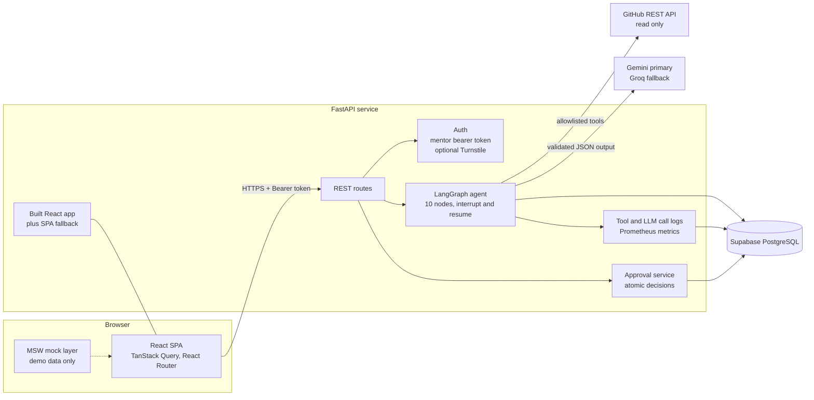
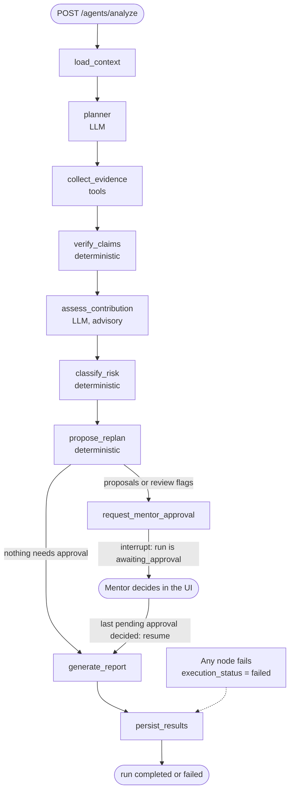
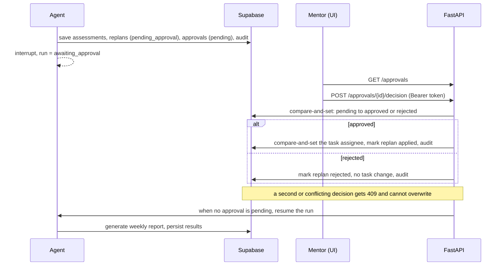
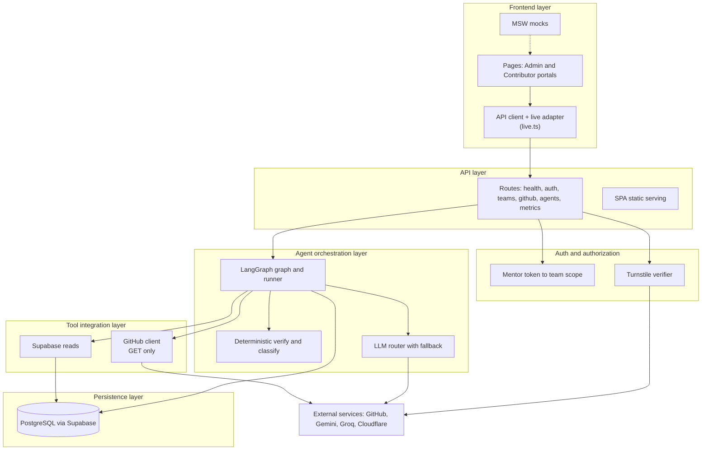
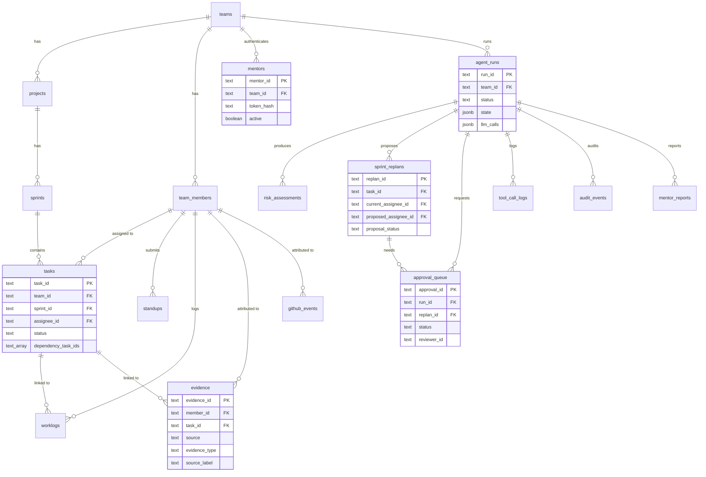
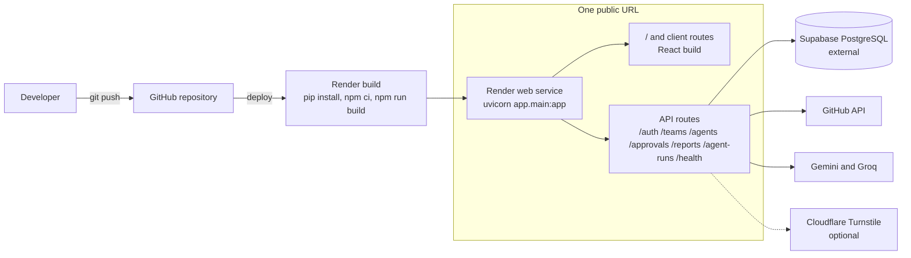

# FairSprint AI

**Fair Work. Clear Evidence. Smarter Sprints.**

FairSprint AI helps mentors run collaborative internship and software-project teams on evidence instead of impressions. An agent cross-checks what team members *say* they did against the evidence that actually exists (GitHub activity, worklogs, task state), flags uncertainty and contradictions without accusing anyone, proposes sprint adjustments when availability changes, and **leaves every consequential decision to a human mentor**.


> **Status: hackathon prototype.** Core backend and agent behaviour is covered by automated tests that use mocked LLMs and an in-memory database. Several frontend areas run on labelled demo data. See [Feature status](#5-key-features) and [Limitations](#18-limitations-and-future-improvements) before relying on anything here. No demo video, screenshots or public demo link are included because none exist in the repository.

## Contents

[2. Problem statement](#2-problem-statement) · [3. Design philosophy](#3-problem-clarification-and-design-philosophy) · [4. Solution overview](#4-solution-overview) · [5. Key features](#5-key-features) · [6. System architecture](#6-system-architecture) · [7. Agentic workflow](#7-agentic-workflow) · [8. Technology stack](#8-technology-stack) · [9. High-level design](#9-high-level-design) · [10. Database design](#10-database-design) · [11. API architecture](#11-api-architecture) · [12. Security and guardrails](#12-security-and-guardrails) · [13. Evaluation and testing](#13-evaluation-and-testing) · [14. Project structure](#14-project-structure) · [15. Local setup](#15-local-setup-and-installation) · [16. Environment variables](#16-environment-variables) · [17. Deployment](#17-deployment-architecture) · [18. Limitations](#18-limitations-and-future-improvements) · [19. Demo walkthrough](#19-demo-walkthrough) · [20. Engineering principles](#20-engineering-principles)

---

## 2. Problem statement

Mentors of internship and project teams must judge progress they mostly cannot see.

- **Self-reported progress is unreliable.** Standups say "all three tasks are complete" while the task board and the repository disagree, usually by honest mistake, sometimes not.
- **Mentors lack visibility** into who actually contributed what, especially across several sprints and team members.
- **GitHub activity alone misses real work.** Code review, QA, documentation, user research, design and coordination leave few commits but are real contributions.
- **Sprint plans go stale.** When someone becomes unavailable, their open tasks, the team's remaining capacity and task dependencies all change, and re-planning by hand is slow and error-prone.
- **Teams need evidence-backed assessments**, not gut feeling.

### Why commit counting is unfair

A "productivity score" built on commit count rewards the wrong things. It under-counts reviewers, testers, writers, researchers and designers; it over-counts many tiny or mechanical commits; it ignores task difficulty; and a missing API response looks identical to "did nothing". Using it to judge people is both inaccurate and unfair. FairSprint AI deliberately never uses commit count (or any single activity count) as a measure of productivity.

## 3. Problem clarification and design philosophy

**FairSprint AI does:**
- Collect the evidence that is available (task-linked records, worklogs, standups, and read-only GitHub activity).
- Cross-check each member's standup claim against that evidence and against task state.
- Surface uncertainty and contradictions, and say what is *missing*.
- Count several kinds of work: code, PR reviews, issue comments, QA, documentation, research, design, coordination.
- Classify delivery risk and propose sprint adjustments (who could take over an at-risk task, with capacity and dependency checks).
- Keep consequential decisions behind explicit mentor approval, with an audit trail.

**FairSprint AI does not:**
- Treat commit count as productivity.
- Automatically accuse anyone. Output is worded as evidence status, never as a finding of misconduct.
- Equate a missing standup with inactivity.
- Treat an API outage as proof of no activity.
- Reassign tasks without a mentor's approval.

### The four verification statuses

These are assigned by **deterministic code** (`backend/app/agents/verify.py`), not by the language model.

| Status | Meaning in this system |
|---|---|
| `verified` | Substantive evidence linked to the claimed task(s) exists, and no completion claim contradicts task state. |
| `partially_verified` | Some substantive evidence exists, but an explicit completion claim conflicts with task state (for example "complete" for a task still `todo`). Goes to mentor review. |
| `unverified` | A completion claim contradicts task state **and** there is no substantive linked evidence **and** no evidence source was unavailable. Goes to mentor review; the recommended action asks for clarification and states it is not a finding of misconduct. |
| `insufficient_evidence` | Not enough to judge: no standup in the window, no substantive linked evidence without a contradiction, or an evidence source was unavailable. The record states what is missing and explicitly says this is not evidence of non-contribution. |

"Substantive" currently means: a worklog of at least 1 hour, or any other item whose title has at least 12 characters. Standup text is self-reported and is never counted as independent evidence. This is a simple heuristic with known weaknesses (see [Limitations](#18-limitations-and-future-improvements)).

## 4. Solution overview

**Mentor journey (live backend):**
1. Sign in with a mentor token (optionally behind a Cloudflare Turnstile check).
2. Open the Agent Center and start a sprint analysis.
3. The agent runs, collects evidence, verifies claims and proposes any sprint adjustments, then **pauses at `awaiting_approval`**.
4. Review each recommendation and formal risk review with its cited evidence, then approve or reject.
5. Approving a reassignment applies it once and records it; rejecting changes nothing.
6. When the last pending approval is decided, the run resumes and drafts the weekly report.
7. Inspect the run trace: every tool call and every LLM provider attempt.

**Team-member journey:** the contributor portal (tasks, standups, blockers, contributions) is implemented in the frontend **against demo data only**. The live backend currently knows mentors, not contributors. See [Feature status](#5-key-features).

## 5. Key features

### Status legend

| Label | Meaning |
|---|---|
| **Implemented** | Works in the backend and is covered by automated tests (mocked LLMs, in-memory database). |
| **Partial** | Works but with a documented gap. |
| **Mocked** | Frontend demo data only (MSW). Not connected to the backend. |
| **Planned** | Not built. |

### Feature groups

| Feature | Status | How it works |
|---|---|---|
| **Evidence collection** | Implemented / Partial | Reads persisted `evidence` rows (task-linked fixtures, worklogs, standup claims) and, when GitHub is configured, live read-only GitHub activity (commits, PRs, reviews, issues, issue comments). Every item carries `source_label` (`synthetic` or `live`). **Partial:** live GitHub items are attributed to members by GitHub username but have **no task link**, so they appear in the evidence but do not support per-task verification. |
| **Claim verification** | Implemented | `verify_member` matches a member's claimed task ids to that member's own evidence for those tasks, and compares explicit completion claims to task status. Pure functions, no I/O. |
| **Contribution assessment** | Implemented | An LLM (Gemini, with Groq fallback) writes an advisory interpretation per member from structured evidence. It **cannot** raise or lower a status; its cited evidence ids are filtered to evidence the member owns. |
| **Sprint risk identification** | Implemented | `classify` maps verification to `risk_level` (`none`, `low`, `review_required`) and a recommended action. Only `review_required` creates a formal mentor risk review. |
| **Sprint replanning** | Implemented | `propose_replan` finds open tasks owned by unavailable members and proposes an available member with enough remaining capacity and skill overlap, plus a dependency check. It is a proposal only and never changes assignments. The trigger "mark a member unavailable" in the UI is **Mocked**. |
| **Human approval** | Implemented | Approvals are persisted rows decided through `POST /approvals/{id}/decision`. Decisions are atomic compare-and-set, rollback-safe and audited. See [approval flow](#approval-flow). |
| **Weekly reporting** | Partial | `GET /reports/weekly` returns a report generated by the agent from persisted assessments, approvals and decisions. It is **rule-based text, not an LLM narrative**. |
| **Observability and traces** | Implemented / Partial | `GET /agent-runs/{id}/tool-calls` and `/llm-calls` expose persisted logs; `GET /metrics` exposes Prometheus metrics. **Partial:** some fields are not recorded and are returned as `null` (never estimated); the audit trail is written but has no read endpoint. |
| Standup participation view | Partial | Computed in the browser from live standups and members; no backend endpoint. |
| Contributor portal, claims-vs-evidence view, standup reminders, invitations, GitHub OAuth connect, Reliability Lab, evaluation runner UI, pause/resume/stop/retry controls | **Mocked** | Served by MSW demo data and labelled as not connected in the UI. See [`docs/LIVE_INTEGRATION.md`](docs/LIVE_INTEGRATION.md). |
| LLM-written report narrative, run listing endpoint, audit-trail read API, per-claim verdicts | **Planned** | Listed as backend gaps in `docs/LIVE_INTEGRATION.md`. |

## 6. System architecture



## 7. Agentic workflow

The agent is a LangGraph `StateGraph` of ten nodes (`backend/app/agents/graph.py`). It is a **linear pipeline with conditional edges and one human interrupt**, not an open-ended loop; graph steps are hard-bounded (`recursion_limit=30`).

| Node | Responsibility | LLM? |
|---|---|---|
| `load_context` | Load team, sprint, members, tasks and standups for the window; build one claim per member; detect and audit prompt-injection attempts in standup text. | No |
| `planner` | Ask the model which claims to verify and which sources to query. Output is validated; unknown members and non-allowlisted sources are discarded, and a coverage rule adds any claim the plan omitted. | Yes |
| `collect_evidence` | Call allowlisted tools: persisted evidence from Supabase and live GitHub activity. Each call is timed, logged and may fail without being treated as "zero". | No |
| `verify_claims` | Deterministic claim-versus-evidence matching per member; checks every evidence reference resolves. | No |
| `assess_contribution` | Model interprets each member's evidence. Cited ids are restricted to that member's own evidence; unknown or duplicate members are ignored. | Yes (advisory) |
| `classify_risk` | Deterministic status, risk level and recommended action. | No |
| `propose_replan` | Deterministic reassignment proposals with capacity and dependency checks. | No |
| `request_mentor_approval` | Persist assessments, replans and approval rows; **interrupt** and set the run to `awaiting_approval`. | No |
| `generate_report` | Build the weekly report from persisted rows, including decisions. | No |
| `persist_results` | Save tool logs, audit the outcome, set the run `completed` or `failed`. | No |



**How the agent observes tool results and handles failure.** The agent does not retry in a loop. Every tool call records status, latency and result count in state and in `tool_call_logs`. A failed or partial source is recorded in `tool_errors` and flows into classification: affected members become `insufficient_evidence` with a note naming the unavailable source, never `unverified`. If both LLM providers fail, or a node raises, the run ends `failed` with its checkpointed state preserved and fabricates nothing. A failed run can be started again under the same run id. After a restart, a run paused for approval resumes from its persisted state in `agent_runs.state`.

### Approval flow



## 8. Technology stack

| Technology | Purpose | Why it was selected | Where it is used |
|---|---|---|---|
| Python, FastAPI | API server | Typed request/response models, dependency injection used for auth and team scope, generated OpenAPI docs | `backend/app` |
| Pydantic, pydantic-settings | Validation and configuration | Strictly validated LLM output and typed environment settings | `schemas/`, `config.py`, `agents/llm.py` |
| LangGraph | Agent orchestration | Native interrupt/resume for the human approval step and checkpointed state | `agents/graph.py`, `agents/runner.py` |
| Gemini (`gemini-3.5-flash-lite` default) | Primary LLM | Primary provider, called with a JSON response type; output is validated against Pydantic schemas | `agents/llm.py` |
| Groq (`openai/gpt-oss-120b` default) | Fallback LLM | A second, independent provider tried when the primary fails (JSON object response format) | `agents/llm.py` |
| HTTPX | HTTP client | Explicit timeouts and testable transports (used for GitHub, LLMs, Turnstile, Supabase pool) | `tools/github.py`, `agents/llm.py`, `services/turnstile_service.py`, `database.py` |
| Supabase (PostgreSQL) | Persistence | Hosted Postgres with a Python client; accessed with the server-side service-role key | `database.py`, `migrations/` |
| GitHub REST API | Evidence source | Read-only commits, PRs, reviews, issues and comments | `tools/github.py`, `services/github_service.py` |
| Cloudflare Turnstile | Bot check on sign-in (optional) | Verified server-side before the mentor token is checked | `services/turnstile_service.py`, `routes/auth.py` |
| React 19, TypeScript, Vite | Frontend | Typed UI with fast builds | `frontend/src` |
| TanStack Query, React Router | Data fetching, routing | Polling for run status; client-side routes | `frontend/src/api`, `App.tsx` |
| Tailwind CSS, shadcn/ui (Base UI), Recharts, Framer Motion | UI | Component system and charts | `frontend/src/components`, `pages/` |
| MSW | Demo/mocked API | Lets the UI run without the backend and covers features the backend lacks | `frontend/src/mocks` |
| Pytest, Vitest | Tests | Deterministic backend tests; frontend unit tests | `backend/tests`, `frontend/src/lib/*.test.ts` |
| Render | Hosting (single web service) | One public URL for UI and API | see [Deployment](#17-deployment-architecture) |
| Docker, docker-compose | Optional local stack | Backend and an nginx-served frontend as two containers | `docker-compose.yml`, [`docs/DOCKER.md`](docs/DOCKER.md) |

An `OPENAI_API_KEY` setting is declared in `config.py` but is not used by any code.

## 9. High-level design



- **Frontend layer:** React pages, a typed API client, and `live.ts`, an adapter that sends calls from a mentor-token session to the real backend and keeps everything else on mocks.
- **API layer:** FastAPI routes with Pydantic models and a uniform error body `{code, message, detail}`.
- **Authentication and authorization:** opaque mentor bearer token, looked up by SHA-256 hash; every team-scoped route compares the mentor's team to the requested team.
- **Agent orchestration:** LangGraph runs the pipeline; verification and classification are plain deterministic functions; the LLM router handles providers, retries and fallback.
- **Tool integration:** an allowlist of three tools (`supabase.load_context`, `supabase.read_evidence`, `github.collect_activity`) with a per-run call budget of 20.
- **Persistence:** all state lives in Supabase PostgreSQL; the in-process checkpointer only enables live interrupt/resume, and a durable copy is in `agent_runs.state`.
- **External dependencies:** GitHub, Gemini, Groq, Supabase and (optionally) Cloudflare.

## 10. Database design

Schema source: [`backend/migrations/001_fairsprint_schema.sql`](backend/migrations/001_fairsprint_schema.sql), [`002_agent_runtime.sql`](backend/migrations/002_agent_runtime.sql), [`003_tool_call_started_at.sql`](backend/migrations/003_tool_call_started_at.sql). Primary keys are `text` ids. Every table has a `team_id` and almost every row a `source_label` (`synthetic` | `live`).



**Notable constraints.** Check constraints restrict `status`, `priority`, `availability_status`, `proposal_status`, `source_label` and similar columns to fixed values; `weekly_capacity_hours`, `hours` and `estimate_hours` must be non-negative; foreign keys use `on delete cascade` to the team and `on delete set null` for optional links. `approval_queue.reviewer_id` has no foreign key because mentors are not team members. `updated_at` triggers are installed on the main tables.

**Team isolation.** Isolation is enforced **in the application**: each route resolves the mentor's `team_id` from the token and rejects other teams (401/403). Row Level Security is enabled on the data tables and on `mentors`, but **no RLS policies are defined**: that locks the tables against the public anon/authenticated API, while the backend uses the service-role key, which bypasses RLS. RLS behaviour has **not** been tested against a live database (unverified).

`github_events` exists in the schema (and the seeder writes evidence derived from it); live GitHub activity is not persisted there by the agent.

## 11. API architecture

Interactive documentation (Swagger UI) is served by FastAPI at **`/docs`** (and `/redoc`, `/openapi.json`) when the backend is running. The frontend's intended contract, including features that are only mocked, is in [`docs/API_CONTRACT.md`](docs/API_CONTRACT.md); the implemented subset is below.

Errors use `{"code": "...", "message": "...", "detail": null}`. Auth failures return 401 and wrong-team access returns 403 without echoing data.

| Group | Endpoint | Auth | Behaviour |
|---|---|---|---|
| Health | `GET /health` | Public | Status and whether Supabase is configured. |
| Sign-in | `POST /auth/mentor-login` | Mentor token (bearer) + Turnstile token in the body when enabled | Verifies Turnstile **first**, then the mentor token, so it cannot be used to probe which tokens exist. Returns `{mentor_id, team_id, name}`. |
| Team data | `GET /teams/{team_id}/dashboard`, `/members`, `/tasks`, `/standups`, `/evidence` | Mentor token, own team only | Paged lists (`limit` up to 500) with filters. 403 for any other team, identical for unknown teams. |
| GitHub | `GET /github/activity` | Mentor token; a `team_id` must be the mentor's team | Live, read-only activity normalised to evidence. Always HTTP 200 with `source_status` of `ok`, `partial` or `unavailable`; unavailable is never "zero activity". |
| Agent | `POST /agents/analyze` | Mentor token, own team | Starts or returns the idempotent run for the team, sprint and date. Runs in the background by default; `wait: true` runs synchronously. |
| Runs | `GET /agent-runs/{run_id}` | Mentor token, run's team | Plan, evidence summary, assessments, replans, approvals, tool and LLM calls. |
| Traces | `GET /agent-runs/{run_id}/tool-calls`, `/llm-calls` | Mentor token, run's team | Persisted logs. Unrecorded fields are `null`. LLM attempts are regrouped into one entry per model call with the provider chain. |
| Approvals | `GET /approvals`, `POST /approvals/{id}/decision` | Mentor token, approval's team | Pending list; atomic approve/reject. 409 `already_decided` for conflicts, 409 `stale_proposal` if the task changed hands. |
| Reports | `GET /reports/weekly` | Mentor token | Latest report for the mentor's team, optionally `?run_id=`. 404 ("No report yet") until the agent has generated one, which happens after the run's approvals are decided. |
| Operations | `GET /metrics` | Bearer `METRICS_TOKEN` if set, **open if empty** | Prometheus text: HTTP latency percentiles, LLM and tool call metrics. See [`docs/METRICS.md`](docs/METRICS.md). |
| Admin | `POST /teams/{team_id}/seed` | `X-Admin-Token` equal to `SEED_ADMIN_TOKEN`; disabled when unset | Idempotent import of the synthetic dataset. |

When the frontend build is present, every other `GET` path serves the React app; unknown paths under the API prefixes return a JSON 404.

## 12. Security and guardrails

Each protection below is backed by tests in [`backend/tests/test_guardrails.py`](backend/tests/test_guardrails.py) unless noted. The suite also contains seven **known-gap** tests (see the table).

| Area | Status | What is implemented |
|---|---|---|
| Authentication | Implemented | Opaque `fsm_…` mentor tokens; only the SHA-256 hash is stored; inactive mentors, wrong schemes and tokens in the URL are rejected. No token expiry; replacing a token means re-running the CLI, which overwrites the mentor's hash. |
| Authorization and team scope | Implemented | All team-scoped routes (including team data and `/github/activity`) return 401/403; unknown and foreign teams answer identically. |
| Bot protection | Implemented (optional) | Cloudflare Turnstile verified server-side: hostname and action checks, replay refusal, bounded timeout, fails closed. Off by default. |
| Prompt injection | Implemented for standups and the model boundary; **gap** for other evidence | Untrusted content is serialised as lossless HTML-safe JSON inside a single `<untrusted_data>` block that content cannot close; system prompts forbid following it; standup injection attempts are detected and audited; model output is schema-validated. Injection text inside commit messages, comments or worklogs is **not** flagged (gap). |
| LLM cannot decide | Implemented | Statuses are deterministic; the model's opinion is advisory and cannot raise or lower them. |
| Evidence grounding | Implemented | Assessments cite persisted evidence ids; invented ids are dropped; a member's assessment may cite only that member's own evidence; API failures become `insufficient_evidence`, not zero. |
| Fairness | Implemented | Assessments are invariant to names, roles and commit volume (tested); missing standups never flag anyone; accusatory labels are scrubbed from model text (fixed list only: **gap** for other wording). |
| Tool permissions | Implemented | Allowlist of three tools and a 20-call budget; GitHub client is GET-only, validates path arguments, validates owner/repo names and refuses pagination links outside the repository; retries are bounded. The agent graph can write only its own tables, and only the approval service changes task assignments (tested by source scan). |
| Human approval | Implemented | Interrupt before consequential changes; atomic compare-and-set decisions; rejected or decided approvals are never overwritten; failures roll back; retries are idempotent. |
| Audit trail | Partial | Run start, approval requested/decided, reassignment (with before/after and actor), injection-ignored and run outcome are written to `audit_events`. There is no read endpoint. |
| Secret handling | Partial | Secrets live in server environment variables; the Turnstile secret and full tokens are never logged; prompts and model responses are not logged; names, emails and usernames are not sent to the model (tested). **Secret redaction inside evidence text is not implemented (gap):** a token pasted into a commit message would reach the LLM provider. |
| Bounded execution | Implemented / Gap | Graph recursion limit, per-run LLM attempt budget, 2 attempts per provider, tool-call budget. **Gap:** a run orphaned by a crash stays `running` and cannot be restarted. |
| CORS | Configurable | `CORS_ORIGINS` (default: local Vite origins), credentials allowed. Not needed when one service serves both UI and API. |
| API rate limiting | **Not implemented** | Only outbound backoff to GitHub and LLM providers. |
| Row Level Security | Enabled, **unverified** | Enabled without policies; the backend's service-role key bypasses it. Not tested against a live database. |
| `/metrics` exposure | Needs configuration | Open when `METRICS_TOKEN` is empty. |

**Known gaps (pinned as expected failures in the test suite):** no secret redaction in evidence; injection in non-standup evidence is not flagged; accusatory wording scrub is a fixed list; orphaned `running` runs; weak "substantive" heuristic (a junk 12-character title counts); and completion claims phrased without the word "task" are not detected.

> This project is a prototype. It has not been penetration-tested, and nothing here should be read as a claim of production readiness.

## 13. Evaluation and testing

### Running the tests

```powershell
# Backend (from the backend folder, virtual environment active)
pytest
# Frontend (from the frontend folder)
npm test
npm run build
```

### Latest results (run for this README, 2026-10-31)

| Suite | Result |
|---|---|
| Backend `pytest` | **245 passed, 7 expected failures** (`xfail(strict)`: the known gaps above) |
| Frontend `npm test` (Vitest) | **8 passed** |
| Frontend `npm run build` (`tsc -b && vite build`) | Succeeds |
| Frontend `npm run lint` (oxlint) | Runs; reports warnings (React purity and fast-refresh), no errors |

Backend tests use scripted LLM providers, an in-memory Supabase fake and mocked HTTP transports. `backend/tests/live_checks.py` is intended for real-service checks; it was **not run** for this README, so real Gemini, Groq, GitHub and Supabase behaviour is unverified here.

### Agent evaluation methodology

The guardrails suite includes a scorecard (`pytest tests/test_guardrails.py -s`) over a **labelled corpus of 22 authored cases**: 9 genuine contributions (code, QA, documentation, research, design, coordination, completion on a done task, volume-independence, review plus worklog), 10 unsupported claims, and 3 genuinely uncertain cases. Definitions:

- **False positive:** a genuine contribution not classified `verified`.
- **False negative:** an unsupported claim classified `verified`.
- **Evidence coverage:** share of assessments that cite evidence or state what is missing; and share of `verified` assessments that cite evidence.
- **Approval compliance:** share of approval attempts (unauthorised, duplicate, racing, rolled back, authorised) where state changed only when it was allowed to.
- **Failure recovery:** share of injected faults (provider outages, malformed output, GitHub rate limit, database outage, invalid evidence, restart) that ended safely and recovered after the fault was fixed.

| Metric (development set) | Result |
|---|---|
| False-positive rate | 0 / 9 |
| False-negative rate, core cases | 0 / 7 |
| False-negative rate including 3 known-gap cases | 3 / 10 (junk title, two completion phrasings) |
| Uncertain cases handled correctly | 3 / 3 |
| Evidence coverage | 22 / 22; 12 / 12 verified cite evidence |
| Approval compliance | 13 / 13 |
| Failure handling / recovery | 11 / 11 safe; 11 / 11 recovered |

### Limitations of this evaluation

- **These are development-set results.** The cases were written by the same people who wrote the code, so they measure that the guardrails behave as designed, not how the system generalises.
- **No independent holdout results are reported.** `data/synthetic_dataset/evaluation_cases.csv` contains 20 scenarios and was deliberately **not used** to design or tune any logic or tests. No automated runner computes metrics over it: the UI's "Reliability Lab" and evaluation results are mocked and return `not_run`.
- Rates over so few cases are indicative, not statistically meaningful.
- The model is scripted in tests, so real-LLM behaviour on adversarial content is untested. No latency or throughput benchmark is claimed here; [`docs/METRICS.md`](docs/METRICS.md) documents the metrics endpoint and its own measurements.

## 14. Project structure

```text
finale_ziro/
├── backend/
│   ├── app/
│   │   ├── main.py            # app wiring, middleware, router order, SPA mount
│   │   ├── config.py          # all settings (environment variables)
│   │   ├── auth.py            # mentor token auth and team scope
│   │   ├── spa.py             # serves the built React app, API routes win
│   │   ├── metrics.py         # in-process Prometheus metrics
│   │   ├── agents/            # graph.py (LangGraph), verify.py (deterministic rules),
│   │   │                      #   llm.py (providers + fallback), runner.py, repository.py, state.py
│   │   ├── routes/            # health, auth, teams, github, agents, metrics
│   │   ├── services/          # approval, trace, dashboard, evidence, github, seed, turnstile
│   │   ├── tools/github.py    # read-only GitHub client
│   │   └── schemas/           # Pydantic models
│   ├── migrations/            # 001 schema, 002 agent runtime, 003 tool-call start time
│   ├── tests/                 # pytest suites (agent, guardrails, trace, turnstile, spa, metrics)
│   ├── Dockerfile
│   └── requirements.txt
├── frontend/
│   ├── src/
│   │   ├── api/               # client.ts, live.ts (live adapter), hooks.ts
│   │   ├── pages/             # admin/ and contributor/ portals, SignIn
│   │   ├── components/        # shared UI, TurnstileWidget
│   │   ├── lib/               # pure logic (+ Vitest tests)
│   │   └── mocks/             # MSW demo data and handlers
│   ├── package.json
│   └── Dockerfile, nginx.conf # used by docker-compose only
├── data/synthetic_dataset/    # fictional demo data (CSV + dataset.json) and its README
├── docs/                      # API_CONTRACT, LIVE_INTEGRATION, METRICS, DOCKER
└── docker-compose.yml
```

## 15. Local setup and installation

**Prerequisites:** Python 3.12+ (developed on 3.12; the Docker image uses 3.13), Node.js (developed on 24; Render settings below use 22), Git, a Supabase project, and optionally Gemini, Groq and GitHub credentials.

```powershell
# 1. Clone
git clone https://github.com/redcode333/finale_ziro.git
cd finale_ziro

# 2. Backend: virtual environment and dependencies
cd backend
python -m venv .venv
.\.venv\Scripts\Activate.ps1
pip install -r requirements.txt -r requirements-dev.txt

# 3. Backend environment (fill in values; never commit .env)
Copy-Item .env.example .env
```

```bash
# macOS / Linux equivalents
python -m venv .venv && source .venv/bin/activate
pip install -r requirements.txt -r requirements-dev.txt
cp .env.example .env
```

**4. Database.** In the Supabase SQL editor run, in order, `backend/migrations/001_fairsprint_schema.sql`, `002_agent_runtime.sql` and `003_tool_call_started_at.sql`.

**5. Seed demo data (optional but needed for the demo).** The seeder reads the dataset ZIP `FairSprint_AI_Gold_Synthetic_Dataset_v2.zip`, which is git-ignored and **not in this repository**; place it in the project root or set `SEED_ZIP_PATH`. The same data is available unzipped in `data/synthetic_dataset/`.

```powershell
python -m app.seed --dry-run   # validate only
python -m app.seed
```

**6. Create a mentor token** (printed once; only its hash is stored):

```powershell
python -m app.mentor_cli create --team team_fs_001
```

**7. Start the backend** (from `backend/`):

```powershell
uvicorn app.main:app --reload --port 8000
```

API docs are at http://localhost:8000/docs.

**8. Start the frontend** (new terminal):

```powershell
cd frontend
npm install
Copy-Item .env.example .env.local
npm run dev
```

The default `.env.example` sets `VITE_USE_MOCKS=true` (demo data) and `VITE_LIVE_API_URL=http://localhost:8000`. In the sign-in page choose **Admin** and paste the mentor token to use the real backend; without a token the app runs entirely on mocks. For a production-style local run, build the frontend (`npm run build`) and start only the backend: FastAPI then serves the app at http://localhost:8000/.

**9. Run the tests:** see [Evaluation and testing](#13-evaluation-and-testing).

## 16. Environment variables

All values below are placeholders; never commit real values.

### Backend (server-side, secret unless noted)

| Variable | Required | Purpose |
|---|---|---|
| `SUPABASE_URL` | Yes (public URL, not secret) | Supabase project URL |
| `SUPABASE_SERVICE_ROLE_KEY` | Yes, **secret** | Server-only database key; bypasses RLS. Never expose it to the frontend. |
| `GEMINI_API_KEY` | For the agent, **secret** | Primary LLM |
| `GROQ_API_KEY` | For fallback, **secret** | Fallback LLM (read by `config.py`; not listed in `.env.example`) |
| `GEMINI_MODEL`, `GROQ_MODEL` | No | Defaults `gemini-3.5-flash-lite`, `openai/gpt-oss-120b` |
| `GITHUB_TOKEN`, `GITHUB_REPO_OWNER`, `GITHUB_REPO_NAME` | For live GitHub evidence, token is **secret** | Read-only GitHub access. Without them GitHub is reported `unavailable`. |
| `AGENT_MAX_ITERATIONS`, `AGENT_TIMEOUT_SECONDS` | No | Bound the LLM attempt budget (default 5 and 60) |
| `CORS_ORIGINS` | No | Comma-separated allowed origins (default local Vite) |
| `LOG_LEVEL`, `APP_NAME` | No | Logging level and display name |
| `SEED_ADMIN_TOKEN` | No, **secret** | Enables `POST /teams/{id}/seed`; disabled when empty |
| `SEED_ZIP_PATH` | No | Path to the dataset ZIP |
| `METRICS_TOKEN` | Recommended, **secret** | Bearer token for `/metrics`; open when empty |
| `FRONTEND_DIST_DIR` | No | Override for the built frontend path (default `frontend/dist`) |
| `PORT` | Set by the host | Used by the start command |

### Optional integration: Cloudflare Turnstile

| Variable | Where | Public? |
|---|---|---|
| `TURNSTILE_ENABLED` | Backend (`true` to enforce; default `false`) | n/a |
| `TURNSTILE_SECRET_KEY` | Backend | **Secret.** Required when enabled; verification fails closed without it. |
| `TURNSTILE_ALLOWED_HOSTNAMES` | Backend | Default `finale-ziro-h79s.onrender.com`; add `localhost` to test locally |
| `VITE_TURNSTILE_SITE_KEY` | Frontend build | **Public** site key |

`OPENAI_API_KEY` is declared but unused.

### Frontend build-time variables (public)

Vite inlines `VITE_*` values into the browser bundle at **build time**, so they must never hold secrets, and changing them needs a rebuild.

| Variable | Purpose |
|---|---|
| `VITE_USE_MOCKS` | `true` starts MSW demo data for features without a backend |
| `VITE_API_BASE_URL` | Base URL for the mock-layer client (normally empty) |
| `VITE_LIVE_API_URL` | Backend URL for mentor-token sessions; empty disables live sign-in |
| `VITE_LIVE_TEAM_ID`, `VITE_LIVE_PROJECT_ID` | Team and project the live adapter targets (defaults `team_fs_001`, `proj_fs_001`) |
| `VITE_TURNSTILE_SITE_KEY` | Public Turnstile site key (optional) |

`frontend/.env.example` also lists `VITE_SUPABASE_URL` and `VITE_SUPABASE_ANON_KEY`; no code currently reads them.

## 17. Deployment architecture

FairSprint AI is intended to run as **one Render web service** that serves both the API and the built React app on a single URL. `render.yaml` is not part of the repository; the settings below are entered in the Render dashboard.

| Setting | Value |
|---|---|
| Runtime | Python |
| Root Directory | **Empty** (the repository root). If set to `backend`, the build cannot see `frontend/` and only the API is served. |
| Build command | `pip install -r backend/requirements.txt && cd frontend && npm ci && npm run build` |
| Start command | `cd backend && uvicorn app.main:app --host 0.0.0.0 --port $PORT` |
| Health check path | `/health` |
| Environment | the backend variables above plus `VITE_USE_MOCKS`, `VITE_LIVE_API_URL` (the service's own URL), `VITE_LIVE_TEAM_ID`, `VITE_LIVE_PROJECT_ID`, and optionally Turnstile; `PYTHON_VERSION` and `NODE_VERSION` as needed |

At startup the backend logs either `Serving the frontend build from …` or a warning that no build was found. API routes are registered first, so they always take precedence over the static-app fallback.



**Deployment status: unverified.** A Render service at `https://finale-ziro-h79s.onrender.com` is the intended target and its `/health` endpoint answered during development. The single-service frontend serving was added later; when this README was written the URL did not respond within 25 seconds (free instances can be asleep), so a working live deployment is **not** claimed. A separate two-container option (backend plus nginx frontend) is documented in [`docs/DOCKER.md`](docs/DOCKER.md).

## 18. Limitations and future improvements

### Current limitations

- **External availability.** GitHub, Gemini, Groq, Supabase and Cloudflare can fail. The system degrades safely (`insufficient_evidence`, failed-but-preserved runs) but cannot produce an assessment without evidence or a model.
- **Live GitHub evidence is not task-linked**, so it does not currently support per-task claim verification; verified outcomes rest on task-linked records and worklogs.
- **Heuristics.** "Substantive evidence" is a length/hours rule; completion claims are detected by a narrow set of phrasings. Both have known false-negative cases (pinned in the test suite).
- **Self-reported worklogs** count as independent evidence and are only labelled by type in the summary.
- **Persistence and checkpoints.** The LangGraph checkpointer is in memory; durable resume relies on `agent_runs.state`. A run orphaned by a crash stays `running`.
- **Atomicity.** Approval decisions are atomic through compare-and-set and verified with an in-memory fake that simulates atomic statements; they have not been exercised against a live database.
- **Evaluation generalisation.** Results are on an authored development set; no independent holdout results; the model is scripted in tests.
- **Mocked functionality.** Contributor portal, claims-vs-evidence view, reminders, invitations, GitHub OAuth, Reliability Lab and run controls are demo data. The production bundle includes the demo dataset because the mock layer imports it.
- **Unverified or missing security controls.** RLS (enabled, no policies, untested live), no API rate limiting, no token expiry, no secret redaction in evidence, `/metrics` open unless `METRICS_TOKEN` is set.
- **Operational.** Metrics are per process and in memory. Analyze is idempotent per team, sprint and date, so a second click returns the existing run.

### Future roadmap (not built)

- Redaction of secrets in evidence; flag injection text in all evidence sources; broaden accusatory-wording protection.
- Link live GitHub activity to tasks (for example via branch, PR or commit references).
- Stale-run recovery with a defensible timeout; run listing and an audit-trail read API.
- Contributor identity and endpoints; an LLM-written, evidence-cited report narrative.
- API rate limiting, token expiry and rotation, RLS policies tested against a live database.
- An independent holdout evaluation run end to end and reported separately.

## 19. Demo walkthrough

Uses the synthetic CampusConnect dataset (fictional people; see [`data/synthetic_dataset/README.md`](data/synthetic_dataset/README.md)). Steps 1 to 10 work against the real backend after setup (migrations, seed, mentor token, Gemini/Groq keys). Without a GitHub token, step 3 shows GitHub as unavailable, which is itself part of the demonstration.

1. **Team context.** Sign in as a mentor; the dashboard shows 8 members, 20 tasks and the active sprint.
2. **Progress claims.** Standups contain claims such as Karan's "All three assigned tasks are complete".
3. **Evidence collection.** Click *Analyze Sprint*. The run collects persisted evidence and calls GitHub; the run trace shows each tool call with status and latency.
4. **Evidence-backed verification.** Neha (QA, PR review, usability documentation) is `verified` despite few commits; Sara's research and design count as work.
5. **Uncertainty and unsupported claims.** Karan's completion claim conflicts with tasks that are still `todo`: `partially_verified` with a clarification request, explicitly not a finding of misconduct. A member with no standup in the window (delete one from the seed data to try it) is `insufficient_evidence`, not inactive.
6. **Sprint risk.** Rohan's temporary unavailability puts task T008 at risk; the agent proposes Diya as the replacement with capacity and dependency checks.
7. **Mentor approval.** The run is `awaiting_approval`. Nothing has changed yet: T008 still belongs to Rohan.
8. **Updated sprint plan.** Approve the reassignment (and the risk review): T008 moves to Diya once, the decision is audited, and the run resumes.
9. **Weekly report.** The report lists verified facts, risks, missing context, unavailable sources and the mentor's decisions.
10. **Run trace.** Open the tool-call and LLM-call views: provider attempts in order, any fallback, and fields that were not recorded shown as such.

Not part of the live walkthrough: the contributor portal, reminders, Reliability Lab and run controls run on demo data.

## 20. Engineering principles

- **Evidence over assumptions.** A claim is only as strong as the evidence linked to it, and absence of evidence is reported as absence, not as failure.
- **Fair assessment over simplistic metrics.** Many kinds of work count; no single activity count decides anything.
- **Human oversight over uncontrolled autonomy.** The agent proposes; a mentor decides; every decision is atomic and audited.
- **Transparency over black-box decisions.** Statuses come from readable rules, the model's role is advisory, and every tool and model call is traceable.
- **Reliability over impressive-looking demos.** Failures are expected, bounded and recoverable; gaps are documented and pinned by tests instead of hidden.

---

*Further reading:* [`backend/README.md`](backend/README.md) · [`frontend/README.md`](frontend/README.md) · [`docs/API_CONTRACT.md`](docs/API_CONTRACT.md) · [`docs/LIVE_INTEGRATION.md`](docs/LIVE_INTEGRATION.md) · [`docs/METRICS.md`](docs/METRICS.md) · [`docs/DOCKER.md`](docs/DOCKER.md)
